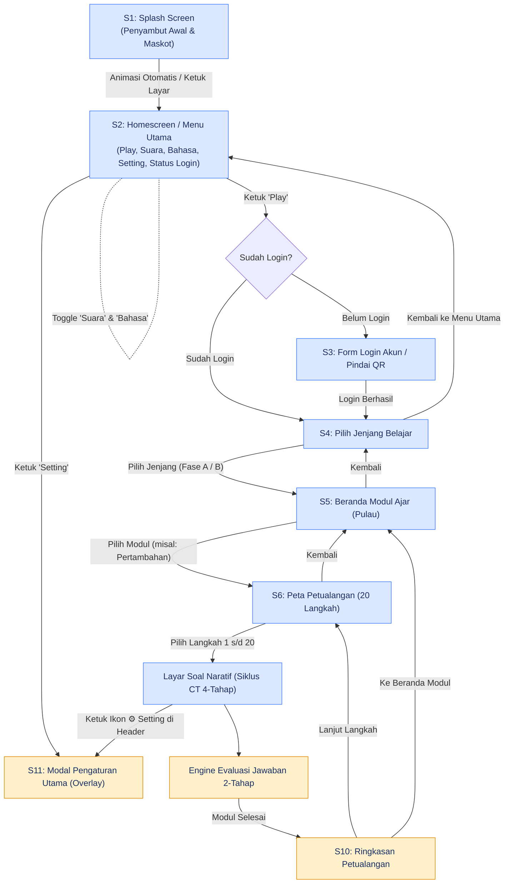
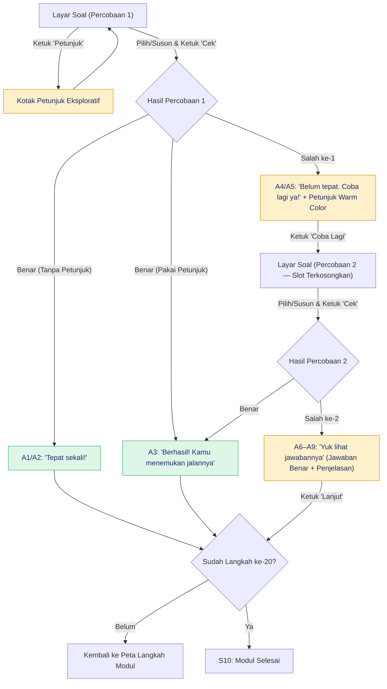

# PRD ThinkAble: Prototipe HTML Interaktif (Versi 2.0 — Revisi Alur & Modul)

**Versi**: 2.0  
**Tanggal**: 4 November 2026  
**Acuan Utama**: Design Rules (`rules.md`), User Flow Final (Splash → Homescreen → Login → Jenjang → Modul → Peta 20 Langkah → Engine 2-Tahap).

## 1. Ringkasan Eksekutif & Tujuan

**ThinkAble** adalah aplikasi media pembelajaran Berpikir Komputasional (*Computational Thinking* / CT) inklusif yang dirancang untuk anak-anak dan remaja, termasuk pengguna yang membutuhkan dukungan belajar khusus. Aplikasi ini menggabungkan materi kurikulum (matematika dan logika dasar) dengan 4 pilar CT: **Dekomposisi, Pola, Abstraksi, dan Algoritma**.

### Tujuan Utama Prototipe:
* Menghadirkan lingkungan belajar yang **bebas stres, bebas persaingan, dan menghargai usaha**.
* Menyajikan alur cerita linier 20 langkah petualangan per modul dengan rotasi CT 4-tahap yang konsisten.
* Mengimplementasikan mesin evaluasi 2-tahap yang ramah tanpa hukuman atau penilaian kuantitatif.

## 2. Aturan Keras Desain (Hard Rules)

Setiap pengembang dan desainer wajib mematuhi aturan keras berikut tanpa pengecualian:

1. **[KERAS] Tanpa Penilaian & Kompetisi**: Tidak ada skor, poin, bintang penghargaan, peringkat/leaderboard, nyawa/lives, hitung mundur/timer, atau gembok level. Dalam kode dilarang menggunakan variabel/kelas bernama `score`, `points`, `rank`, `lives`, `timer`, `level`.
2. **[KERAS] Tanpa Warna Merah**: Evaluasi kesalahan atau pesan 'belum tepat' dilarang menggunakan warna merah (hue 345°–15°). Gunakan warna hangat `--almost` (#E08A00) + ikon info + teks penyemangat hangat.
3. **[KERAS] Makna Multi-Sensori**: Setiap status/makna wajib disampaikan melalui minimal 3 lapisan: Warna + Ikon + Teks/Bentuk (contoh: ubin G2 dibedakan bentuk & pola garis, bukan warna saja).
4. **[KERAS] Landscape Terkunci 800×360 px**: Bingkai aplikasi tetap 800×360 px (rasio 20:9) dengan skala *contain*. Perangkat mode potret (*portrait*) menampilkan layar peringatan putar layar (`X1`).
5. **[KERAS] Interaksi Ketuk Murni**: Semua mekanisme penyusunan (seperti Robot Kurir S6b dan Susun Bagian G9) mengandalkan **ketuk chip ke slot**, dilarang menggunakan *drag-and-drop* sebagai satu-satunya cara.
6. **[KERAS] Ukuran Aksesibel**: Target sentuh minimal 48 px, teks minimal 14 sp. Tata letak harus tetap utuh dan tidak terpotong pada pembesaran teks 150% (A++).
7. **[KERAS] Istilah Baku**: Algoritma, Pola, Abstraksi, Dekomposisi. Kata terlarang di antarmuka: `Salah!`, `Gagal`, `Skor`, `Level`, `Peringkat`, `Kalah`, `Menang`, `Nilai`, `Poin`, `Bintang`.
8. **[KERAS] Teks Terpusat di `STR`**: Semua teks tampilan antarmuka diambil dari objek `STR` (Bahasa Indonesia), tidak ada *hardcode* teks di markup HTML.

## 3. Peta Navigasi & User Flow Final

### 3.1 Diagram Alur Utama (Mermaid)



## 4. Rincian Spesifikasi Layar

### `S1` · Splash Screen
* **Tampilan**: Logo utama ThinkAble, animasi penyambut maskot (Lumi & Kiko).
* **Perilaku**: Transisi otomatis (*auto-advance*) dalam 2.5 detik atau ketuk layar menuju `S2_HOME`.

### `S2_HOME` · Homescreen / Menu Utama
* **Header/Pusat Kontrol**:
  * ▶ **Tombol Play** (Aksi Utama, besar di tengah).
  * 🔊 **Toggle Suara**: Menyalakan/mematikan sound effect & narasi.
  * 🌐 **Toggle Bahasa**: Alih bahasa (Bahasa Indonesia / English).
  * ⚙️ **Tombol Setting**: Membuka modal Pengaturan (`S11_SET`).
  * 👤 **Status Login**: Menampilkan nama profil aktif atau tombol *"Masuk Akun"*.

### `S3_LOGIN` · Form Login Akun
* **Fitur**: Masuk menggunakan Nama Panggilan/ID Peserta, atau tombol **Pindai QR Code** (simulasi kamera `getUserMedia` / tombol simulasi).

### `S4_JENJANG` · Pilih Jenjang Belajar
* **Pilihan**:
  * PAUD / Transisi
  * Fase A (Kelas 1–2)
  * Fase B (Kelas 3–4)

### `S5_MODUL` · Beranda Modul Ajar (Pulau Tematik)
* **Konsep**: Kartu pulau linier bermuatan materi ajar, contoh:
  * *Pulau Pertambahan* (Lembah Apel & Keranjang Buah)
  * *Pulau Pengurangan* (Sungai Pijakan Batu)
  * *Pulau Bangun Datar* (Kota Geometri)
  * *Pulau Pengukuran* (Jembatan Timbangan Kayu)
* **Catatan Kemajuan**: *"Kamu sudah mencoba 5 langkah di Pulau Pertambahan."* (Tanpa persentase/gembok).

### `S6_PETA` · Peta Petualangan 20 Langkah
* **Tampilan**: Jalur 20 titik langkah bergaya buku cerita interaktif.
* **Indikator Titik**:
  * Centang + Terisi (`✓`): Langkah selesai.
  * Cincin Tebal (`◯`): Langkah aktif / siap dimainkan.
  * Lingkaran Kosong (`○`): Langkah belum dijalankan.
* **Header**: Tombol Kembali (`‹`) dan Tombol ⚙️ Setting (Overlay).

## 5. Kurikulum Modul, 20 Langkah & Rotasi CT 4-Tahap

Di dalam setiap modul 20 langkah, tantangan Berpikir Komputasional berputar secara konsisten setiap 4 langkah:
$$
\text{Langkah 1: Dekomposisi} \longrightarrow \text{Langkah 2: Pola} \longrightarrow \text{Langkah 3: Abstraksi} \longrightarrow \text{Langkah 4: Algoritma}
$$

### Matriks Siklus 20 Langkah (Contoh: Pulau Pertambahan)

| Siklus | Langkah | Pilar CT | Jenis Tantangan Interaktif | Kode Template Layar |
| :--- | :--- | :--- | :--- | :--- |
| **Siklus 1** | Langkah 1 | **Dekomposisi** | Memisahkan kelompok buah apel & jeruk sebelum dijumlahkan. | `G9` (Susun Bagian) |
| | Langkah 2 | **Pola** | Melengkapi pola irama deret buah (1 apel, 2 apel, 1 apel, ...). | `G1` / `G2` (Pilih 1 dari 3) |
| | Langkah 3 | **Abstraksi** | Memilih keranjang buah penting, mengabaikan hiasan ulat/daun. | `G8` (Pilih 2 dari 4) / `G3` |
| | Langkah 4 | **Algoritma** | Menyusun 3 rute langkah Kurir Kiko membawa buah ke Rumah. | `S6b` (Susun 3 Langkah) |
| **Siklus 2** | Langkah 5 | **Dekomposisi** | Memecah bilangan penjumlahan menjadi puluhan & satuan. | `G9` (Susun Slot) |
| | Langkah 6 | **Pola** | Menemukan ubin pola loncat penjumlahan (+2, +2). | `G2` (Ubin Hilang) |
| | Langkah 7 | **Abstraksi** | Memilih catatan angka yang relevan untuk transaksi buah. | `G4` (Peta/Pilihan Sederhana) |
| | Langkah 8 | **Algoritma** | Menyusun urutan langkah menimbang buah. | `S6b` (Susun Langkah) |
| **Siklus 3** | Langkah 9 | **Dekomposisi** | Membagi tugas memetik buah menjadi 3 langkah bagian kecil. | `G6` / `G9` |
| | Langkah 10 | **Pola** | Menentukan pola susunan batu pijakan di sungai. | `G7` (Isi 2 Batu) |
| | Langkah 11 | **Abstraksi** | Memilih alat hitung utama yang wajib dibawa ke pasar. | `G8` (Pilih Multi) |
| | Langkah 12 | **Algoritma** | Menyusun jalur rute kurir agar tidak menabrak rintangan. | `S6` (Pilih 1 Arah) |
| **Siklus 4** | Langkah 13 | **Dekomposisi** | Membagi bahan adonan pie apel menjadi 3 bagian persiapan. | `G9` (Susun Bagian) |
| | Langkah 14 | **Pola** | Melengkapi pola potongan pie di nampan saji. | `G1` (Pilih Irama) |
| | Langkah 15 | **Abstraksi** | Memilih bahan resep utama yang dibutuhkan. | `G3` (Bawa yang Penting) |
| | Langkah 16 | **Algoritma** | Menyusun urutan memanggang pie di dapur. | `S6b` (Susun Langkah) |
| **Siklus 5** | Langkah 17 | **Dekomposisi** | Membagi porsi pie apel untuk seluruh peserta pesta hutan. | `G9` (Susun Bagian) |
| | Langkah 18 | **Pola** | Melengkapi pola susunan kursi berulang di meja pesta. | `G2` (Ubin Hilang) |
| | Langkah 19 | **Abstraksi** | Memilih hadiah paling penting untuk puncak acara. | `G8` (Pilih 2 dari 4) |
| | Langkah 20 | **Algoritma** | **Puncak Modul**: Menyusun 4 urutan langkah penutupan pesta. | `S6b` (Susun 4 Langkah) |

## 6. Spesifikasi Mesin Evaluasi Jawaban 2-Tahap

### 6.1 Diagram Flowchart Evaluasi (Mermaid)



### 6.2 Aturan Operasional Engine:
1. **Percobaan Pertama Salah (`A4`/`A5`)**:
   * Tampilan masuk ke warna hangat `--almost-bg` (#FFF0CC).
   * Menampilkan teks petunjuk eksploratif (`hints[0]`).
   * Jawaban benar **TIDAK ditampilkan**.
   * Tombol utama: *"Coba lagi"* (membuka soal percobaan 2 dengan pilihan terkosongkan).
2. **Percobaan Kedua Salah (`A6`–`A9`)**:
   * Menampilkan jawaban benar beserta teks penjelasannya ("Yuk lihat jawabannya").
   * Tombol utama: *"Lanjut"* (melangkah ke `NEXT` tanpa branch soal serupa).
3. **Tombol Cek Nonaktif Berlabel Alasan**:
   * Tombol Cek tetap tampil di layar soal dalam keadaan nonaktif (garis putus + abu-abu) dengan alasan lengkap, misal: `Cek (Pilih 1 arah dulu)` atau `Cek (Isi 3 langkah dulu)`.

## 7. Pengaturan Aksesibilitas (`S11_SET`)

Modal Pengaturan (`S11_SET`) dapat dipanggil kapan saja dari Homescreen atau dari ikon ⚙️ di header layar pengerjaan soal. Saat dipanggil di tengah soal, layar dibuka sebagai **overlay** tanpa menghapus status/jawaban yang sedang diisi pengguna.

### Daftar Opsi Pengaturan:
* **Ukuran Teks**: `A` (100%), `A+` (125%), `A++` (150%).
* **Mode Tenang**: Menurunkan saturasi warna 40% dan mematikan animasi gerak.
* **Kontras Tinggi**: Mengubah warna teks menjadi hitam murni (#000000), garis 3 px, membuang pola latar belakang.
* **Getaran (Haptic)**: Mengaktifkan/mematikan `navigator.vibrate`.
* **Kurangi Gerak**: Mematikan transisi layar dan animasi kedip maskot.

## 8. Arsitektur Data & Penyimpanan Lokal

Seluruh progres disimpan secara lokal di `localStorage` browser (dengan try/catch & fallback variabel memori).

### Skema Data (`store`):
```json
{
  "userSession": {
    "isLoggedIn": true,
    "nickname": "Alya",
    "avatar": "penyu",
    "jenjang": "fase_a"
  },
  "settings": {
    "volume": 3,
    "language": "id",
    "textSize": "A",
    "haptic": true,
    "reduceMotion": false,
    "calm": false,
    "highContrast": false
  },
  "progress": {
    "pulau_pertambahan": {
      "completedSteps": [1, 2, 3, 4, 5],
      "currentStep": 6
    }
  }
}
```

## 9. Palette Warna & System Tokens

| Token CSS | Nilai Hex | Peruntukan |
| :--- | :--- | :--- |
| `--ink` | `#1B2F63` | Teks utama, border tebal, tombol utama |
| `--bg` | `#F6F8FF` | Latar belakang aplikasi |
| `--surface` | `#FFFFFF` | Latar kartu / slot |
| `--pes` / `--pes-bg` | `#3D7BFF` / `#DCE8FF` | Warna Peserta, petunjuk, fokus |
| `--ok` / `--ok-bg` | `#2FB36B` / `#DDF6E8` | State Benar (`A1`, `A2`, `A3`) |
| `--almost` / `--almost-bg` | `#E08A00` / `#FFF0CC` | State Belum Tepat / Warning / Dialog |
| `--line` / `--muted` | `#C9C9C2` / `#5F5F5A` | Garis tepi, teks sekunder |

*Catatan: Dilarang keras menambahkan kode warna merah di token CSS atau elemen antarmuka.*
