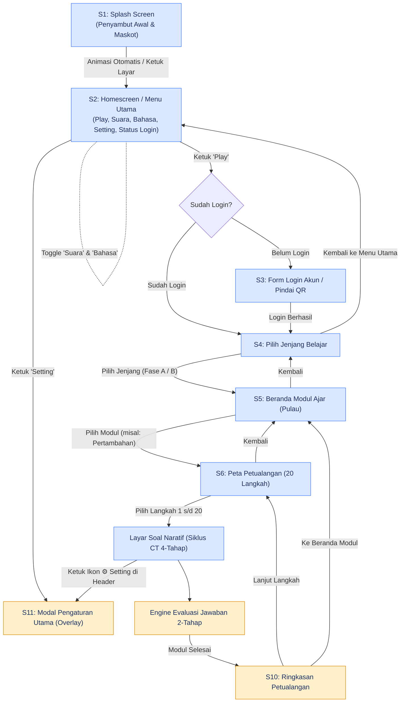
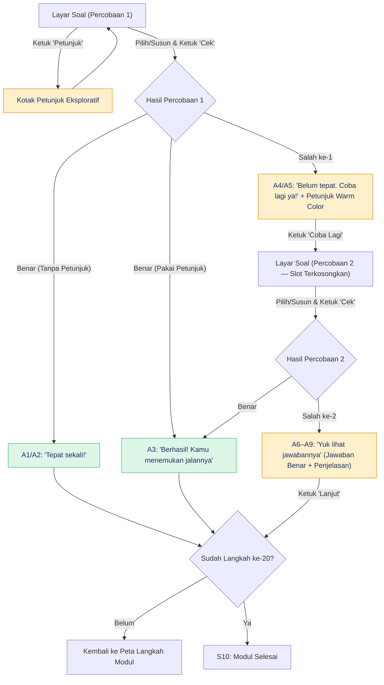

# ThinkAble — User Flow Revisi (Versi 2.0)

Berdasarkan diagram alur resmi revisi v2.0 (Splash → Homescreen → Login → Jenjang → Modul → Peta 20 Langkah → Engine 2-Tahap).

## 1. Alur Navigasi Utama Aplikasi

## 2. Mesin Evaluasi Jawaban 2-Tahap

